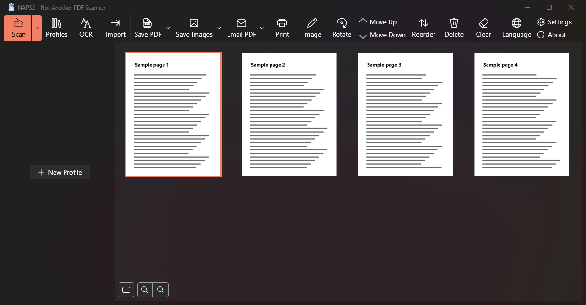
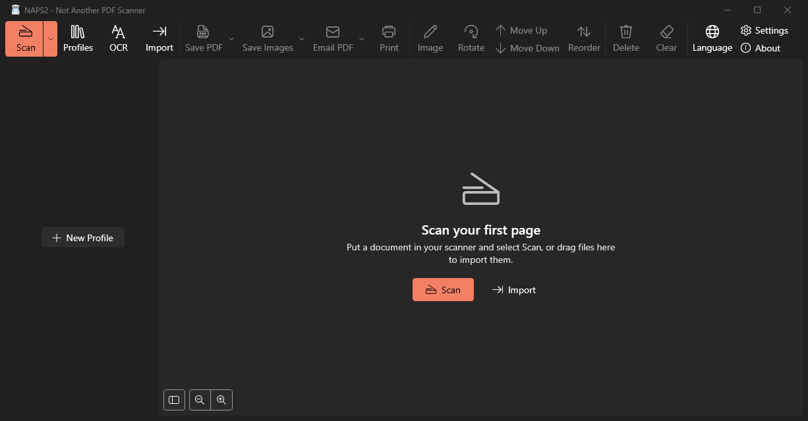

# NAPS2 Modern: Free Open Source Document Scanner for Windows 11

**NAPS2 Modern is a free, open source document scanning app for Windows 11. It scans from WIA, TWAIN, and eSCL scanners, then saves to PDF, searchable PDF, TIFF, JPEG, or PNG.** It is an unofficial fork of [NAPS2 (Not Another PDF Scanner)](https://github.com/cyanfish/naps2) that keeps the same scanning engine and adds a redesigned Fluent interface built with WPF and .NET 10.

<p align="center">
  
</p>

## Features

- **Scan from most scanners:** WIA and TWAIN drivers, plus eSCL for network scanners
- **Save your way:** PDF, TIFF, JPEG, and PNG
- **Make PDFs searchable:** optical character recognition (OCR) with [Tesseract](https://github.com/tesseract-ocr/tesseract)
- **Organize pages:** reorder, rotate, and edit pages before saving, and print or email the result
- **Reuse your settings:** scanner profiles, batch scanning, and auto save
- **Windows 11 design:** Fluent icons, Mica, your system accent color, and light and dark themes
- **Screen reader names:** pages and toolbar dropdowns have meaningful accessible names

## NAPS2 Modern compared with NAPS2

| | NAPS2 Modern | [NAPS2](https://www.naps2.com) |
| --- | --- | --- |
| Project status | Unofficial fork | Original project |
| Windows interface | WPF with Fluent theme | WinForms |
| Toolbar icons | One-color Fluent icons that follow the theme | Color bitmap icons |
| Main action | Scan button in the accent color | Standard toolbar button |
| Start screen | Scan and Import prompts when there are no pages | Empty page list |
| Platforms | Windows | Windows, macOS, Linux |
| Downloads | [Portable zip for Windows x64](https://github.com/nelitow/naps2/releases/latest) | [Installers and portable builds](https://www.naps2.com/download) |
| License | GPL 2.0 or later | GPL 2.0 or later |

NAPS2 Modern is based on NAPS2 8.6.0.

<p align="center">
  
</p>

## Download

1. Download the `win-x64` zip from the [latest release](https://github.com/nelitow/naps2/releases/latest).
2. Extract it to a folder you can write to, because your settings are saved there.
3. Run `NAPS2.Portable.exe`.

There's nothing to install, and you don't need to install .NET.

The builds aren't code signed yet, so Windows SmartScreen may warn you the first time. To continue, select **More info**, then **Run anyway**.

For a good quality document scan, set your profile to 300 dpi and your paper size. New profiles can start lower.

## Build from source

You need Windows and the [.NET 10 SDK](https://dotnet.microsoft.com/download/dotnet/10.0).

```bash
git clone -b feat/modern-ui https://github.com/nelitow/naps2.git
```

```bash
cd naps2
```

```bash
dotnet build NAPS2.App.Wpf -c Release
```

Then run `NAPS2.App.Wpf\bin\Release\net10.0-windows\win-x64\NAPS2.exe`.

## FAQ

### Is NAPS2 Modern free and open source?

Yes. It costs nothing and is licensed under the GNU GPL 2.0 or later, the same as NAPS2. The full source code is in this repository.

### Can I scan on an HP printer without HP Smart?

Yes, as long as Windows can see the scanner. NAPS2 Modern scans through the scanner's standard WIA or TWAIN driver, or over the network with eSCL, so it doesn't need the manufacturer's scanning app. A USB scan was tested on an HP DeskJet 2600 using WIA.

### Does it need location access or an account?

No. Scanning doesn't ask for your location or an account. A search of the source code finds no location APIs and no telemetry libraries. Connecting a Gmail or Outlook account is only for the optional email feature.

### Does it work offline?

Yes, scanning and saving work without an internet connection. It only goes online for things like downloading OCR language files, or checking for updates if you turn that on. The update check currently looks for official NAPS2 releases.

### Which scanners does it support?

Any scanner with a WIA or TWAIN driver, and network scanners that support eSCL. That covers many models from brands such as HP, Canon, Epson, and Brother, but this fork has only been tested with the HP DeskJet 2600.

### Which Windows versions does it run on?

It has been tested on Windows 11 x64. Other versions and Windows on Arm haven't been tested. Mica requires Windows 11.

### Does it work on macOS or Linux?

This fork only changes the Windows interface. For macOS and Linux, use [official NAPS2](https://www.naps2.com/download).

### Is this the official NAPS2?

No. NAPS2 Modern is an independent fork and isn't affiliated with or endorsed by the NAPS2 project. Please report problems with this fork here, not to the NAPS2 developers.

## Credits

The scanning engine, file handling, and most of the app come from [NAPS2](https://github.com/cyanfish/naps2) by Ben Olden-Cooligan and [its contributors](CONTRIBUTORS). You can support the original project by [donating to NAPS2](https://www.naps2.com/donate?src=readme).

## NAPS2.Sdk (for developers)

[NAPS2.Sdk](NAPS2.Sdk) is the scanning library from upstream NAPS2, supporting WIA, TWAIN, SANE, and eSCL scanners on Windows, Mac, and Linux.

## License

NAPS2 Modern is licensed under the [GNU GPL 2.0 (or later)](LICENSE). Some projects have additional license options:

- NAPS2.Escl.* - GNU LGPL 2.1 (or later)
- NAPS2.Images.* - GNU LGPL 2.1 (or later)
- NAPS2.Internals - GNU LGPL 2.1 (or later)
- NAPS2.Sdk - GNU LGPL 2.1 (or later)
- NAPS2.Sdk.Samples - MIT
